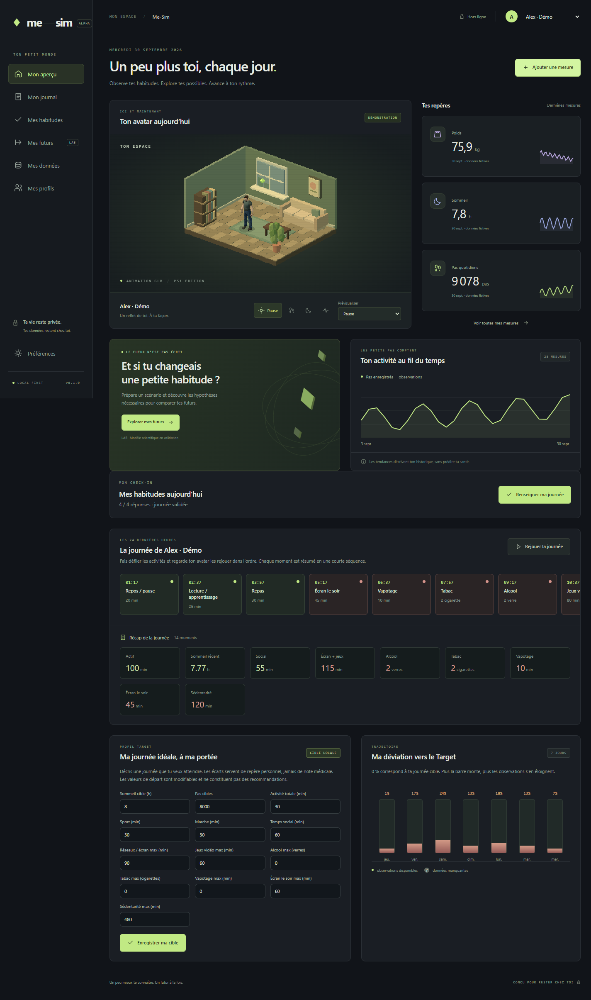

# Me-Sim

Application Windows locale : Angular 22, Tauri 2, SQLite et Three.js. Interface française ou anglaise, thèmes sombre et clair, plusieurs profils et diorama rétro PS1 entièrement construit avec des assets locaux.



## Paquets Windows

Les artefacts de cette livraison sont dans `release/` :

- `Me-Sim_0.1.0_x64-setup.exe` : installation standard, téléchargement de WebView2 si absent.
- `Me-Sim_0.1.0_x64-offline-setup.exe` : installation avec WebView2 embarqué.
- `Me-Sim-0.1.0-updated.exe` : exécutable direct de cette livraison, nécessite WebView2 déjà installé.

Les paquets sont non signés. Ils ne sont pas installés automatiquement sur ton poste.

## Démarrer

Prérequis de développement : Node 24.15+ (24.x), Rust stable MSVC, outils C++ Visual Studio et WebView2. Le téléchargement initial des dépendances nécessite Internet.

```powershell
npm ci
npm run desktop
```

- `npm run build` : compiler Angular.
- `npm run preview` : aperçu navigateur sur http://127.0.0.1:1420, données fictives temporaires, échanges de fichiers désactivés.
- `npm test` : tests Playwright avec Edge installé, sur le port 1421. Exécuter le build avant.
- `npm run docs:dev` : documentation VitePress sur http://127.0.0.1:5174.
- `npm run docs:build` : documentation statique, avec vérification des liens internes.
- `npm run docs:preview` : aperçu du site construit sur http://127.0.0.1:4174.
- `npm run storybook` : catalogue local du design système sur 127.0.0.1:6006.
- `npm run test:visual` : builds et régression visuelle Playwright ; installer Chromium avec `npx playwright install chromium`.
- `npm run test:visual:update` : mise à jour volontaire des références visuelles après inspection.
- `npm run test:rust` : tests Rust des données, fichiers et verrou scientifique.
- `npm run package` : installateur NSIS par utilisateur ; installe WebView2 si nécessaire via Internet.
- `npm run package:offline` : installateur NSIS incluant l’installateur WebView2 hors ligne.

Les versions JavaScript et Rust sont verrouillées par `package-lock.json` et `src-tauri/Cargo.lock`. Les caches peuvent être déplacés dans le projet avec `$env:CARGO_HOME = "$PWD\.cache\cargo"`.

## Ce qui fonctionne

- Menu Français / English disponible dans la barre supérieure et dans les préférences. Changement immédiat des libellés, du calendrier, des dates et des nombres, sans modifier les noms ou textes saisis.
- Thèmes sombre et clair, avec bouton dans la barre supérieure et choix dans les préférences. Langue et thème enregistrés localement pour tous les profils, inclus dans les sauvegardes JSON ; les anciennes sauvegardes utilisent français et sombre par défaut.
- Création, sélection, modification, suppression de profils ; démo séparée et explicitement fictive.
- Saisie, correction et suppression de poids, sommeil, pas, activité, apports, stress déclaré et habitudes horodatées (sport, marche, travail, social, lecture, pauses, réseaux/écran, écran le soir, jeux vidéo, sédentarité, tabac, vapotage, repas et alcool).
- Timeline défilable des 24 dernières heures, récapitulatif de journée et relecture des activités dans l’ordre par l’avatar.
- Profil Target par profil : définition d’une journée de référence (sommeil, pas, activité, tabac, vapotage, écran du soir, sédentarité et autres habitudes) et visualisation de la déviation observée sur les 7 derniers jours ; les jours sans données restent inconnus.
- Écran Mes habitudes : choisir des habitudes à cultiver ou à réduire, en créer de personnalisées, répondre oui/non chaque jour, valider les journées et suivre leur alignement avec le cap souhaité sur 14 jours. Les jours incomplets restent absents de la courbe ; les habitudes retirées restent dans l’historique.
- Historique et courbes d’observations ; données absentes indiquées comme inconnues.
- Scène PS1, animations contextuelles propres à chaque activité (pause, marche, repos, sport, travail, social, écran, écran du soir, jeu, tabac, vapotage, sédentarité, lecture, repas et boisson), accessoires 3D associés, couleur d’avatar, préférences d’animation. Si WebGL est indisponible, un message permet de réessayer la 3D ; les données restent accessibles.
- Caméra 3D interactive : glisser pour orbiter, molette ou boutons +/− pour zoomer (70 à 400 %), bouton ↺ pour retrouver la vue initiale. Au clavier après focus de la scène : flèches, +/− et R ou Début. Chaque aperçu de comparaison possède sa propre caméra ; les commandes sont masquées si le rendu 3D est indisponible.
- Personnages masculin et féminin fournis en FBX (`male_casual` et `female_secretary`), textures originales embarquées et quinze clips chacun, avec deux fichiers Blender éditables. Un profil renseigné **Féminin** choisit automatiquement sa variante dans le tableau de bord et la comparaison. Remplacement des animations par des GLB locaux partagés ou séparés ; [guide pour l’artiste](docs/artist-animation-guide.md) et commande `npm run check:avatar` pour vérifier les exports.
- Scénarios personnels enregistrés et deux avatars illustratifs côte à côte.
- Imports CSV UTF-8, XLS binaire, XLSX multifeuille et tableaux JSON, avec mapping, unités, dates et aperçu paginé.
- Exports CSV, XLS binaire BIFF8, XLSX et sauvegarde JSON complète ; restauration transactionnelle précédée d’une copie JSON.

## Limite scientifique explicite

**Les projections de poids ne sont pas activées.** La commande Rust refuse tout calcul destiné à l’utilisateur. Le module de recherche implémente seulement les équations linéarisées de phase tardive de Hall 2011 ; ce n’est pas le Body Weight Planner complet. Ses tests vérifient des propriétés mathématiques, pas une validation clinique ou une concordance aux études publiées.

Voir [la fiche scientifique](docs/model-card.md) pour les sources, les conditions d’activation et les travaux restants. Aucun coefficient ne transforme arbitrairement sommeil, stress ou pas en poids futur. L’avatar n’est pas une projection anatomique.

## Confidentialité

La base est située sous `%LOCALAPPDATA%\fr.mesim.desktop\me-sim.db`. Son emplacement exact est affiché dans les préférences. Seuls la langue et le thème sont aussi mémorisés dans le cache local de la WebView pour l’affichage au démarrage ; aucune donnée de santé n’y est stockée. Les traductions sont embarquées, sans service distant. Aucun compte, serveur distant, CDN, police externe, analytique ou service d’IA. Pas de mise à jour automatique.

Données non chiffrées, protégées par la session Windows. Les profils ne sont pas des comptes authentifiés. Supprimer un profil supprime ses enregistrements de la base active, mais pas les sauvegardes, exports ou copies système déjà créés ; ce n’est pas un effacement forensique du disque.

La WebView n’accède pas directement au disque ou à SQL. Les fichiers passent par les sélecteurs natifs Rust ; aucun chemin arbitraire n’est fourni depuis JavaScript. Les imports et restaurations sont préparés en mémoire puis confirmés par jeton opaque. L’application n’envoie pas de télémétrie ; les politiques de maintenance propres à Windows/WebView2 restent celles du système.

## Organisation

- `src/app/core` : contrats TypeScript, état Signals, catalogue de traductions embarqué (`translations.ts`), préférences de présentation, icônes, graphique et gestion du focus.
- `src/app/pages` : écrans et formulaires réactifs.
- `src/app/scene` : scène chargée à la demande et libération des ressources GPU.
- `src-tauri/src` : domaines, SQLite, échanges, moteur de recherche et commandes natives.
- `fixtures` : exemples sans données personnelles.
- `docs` : guide, fiche scientifique et validation.

## Documentation

La [documentation VitePress](docs/index.md) reprend les guides Markdown du dossier `docs/` : démarrage Windows, confidentialité, journal et données, animations, architecture, design système, limites scientifiques et revues. Guides français et anglais (`/en/`), navigation et recherche locale traduites, thèmes clair/sombre et ressources embarquées. Le build vérifie la parité des pages et sections entre langues. Le site reste indépendant de Tauri et ne contient aucune donnée personnelle. La CI est configurée pour vérifier le build ; aucune publication automatique n’est configurée.

## Design système

[Guide Storybook et régression visuelle](docs/design-system.md) : composants partagés, thèmes, contrôles, captures de référence et CI Windows. Les sept écrans et la documentation sont capturés aux formats iPhone 16 Pro, iPad Pro 11″, MacBook Pro 14″ et Desktop en français/anglais, clair/sombre.

## Vérification native isolée

Après `npx tauri build --debug --no-bundle`, lancer le binaire avec `ME_SIM_TEST_DATA_DIR` pointant vers un dossier de test et `WEBVIEW2_ADDITIONAL_BROWSER_ARGUMENTS=--remote-debugging-port=9223`. `node scripts/native-smoke.mjs` vérifie que la base est bien dans un chemin contenant `native-smoke` avant toute mutation.

Le changement de répertoire de données est compilé uniquement en debug. Ne pas activer le débogage distant pour une utilisation personnelle réelle.
